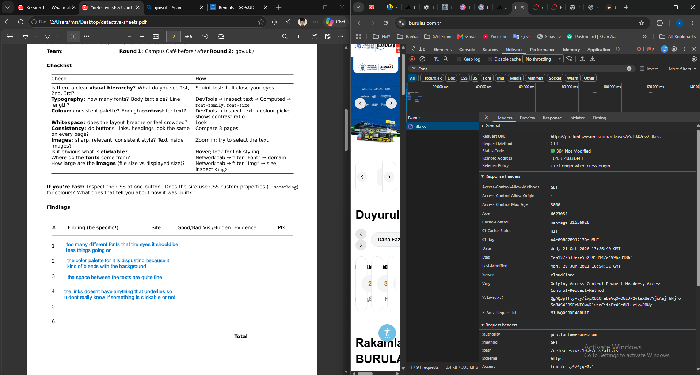
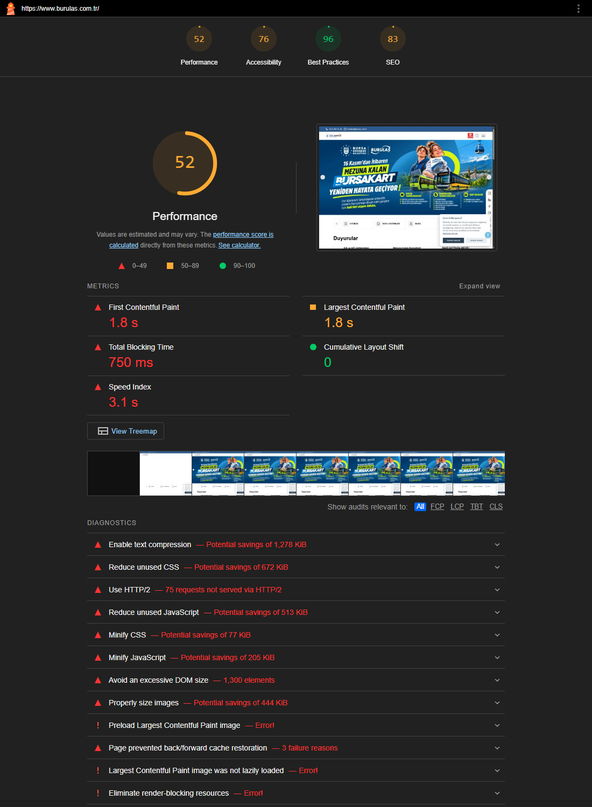
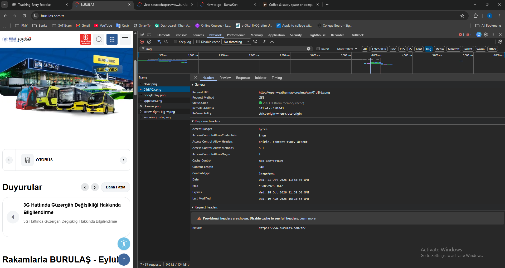
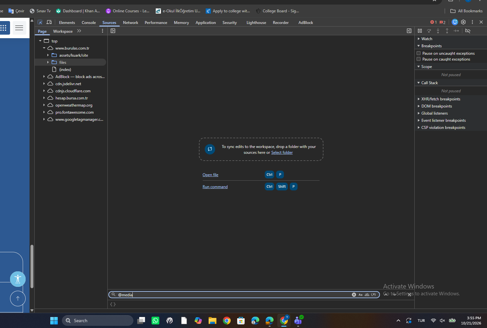
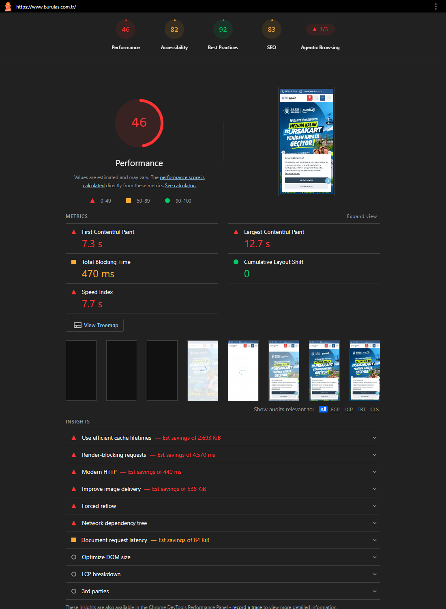

# EPA 1 Delivery Report: burulas.com.tr

Author: Yavuz Eren Yasar
Site analysed: https://www.burulas.com.tr (home page), the public transport company of Bursa
Tools: Chrome DevTools (Network, Sources, Lighthouse), curl
Measured: 21 Oct and 17 Nov 2026

For the new numbers I turned the cache off. "Normal" means desktop without throttling, "Slow 4G" means the mobile test with Slow 4G.

## A1 Totals

| Measure | Normal | Slow 4G |
|---|---|---|
| Requests | 90 | 90 |
| Transferred | 3.3 MB | 3.0 MB |
| First Contentful Paint | 1.8 s | 7.3 s |
| Largest Contentful Paint | 1.8 s | 12.7 s |
| Page usable (interactive) | 3.1 s | 15.5 s |

Explanation: On a normal connection the page is ready after about 3 seconds. On Slow 4G you see almost nothing for 7 seconds and the main content comes after nearly 13 seconds. A lot of people open this site on their phone at a bus stop, so this is too slow.

In my first test on 21 Oct the Network tab only showed 335 kB. The cache was still on and AdBlock blocked some requests, so that number was too low.

## A2 The 3 largest resources

| # | File | Type | Size |
|---|---|---|---|
| 1 | rakamlarla-burulas.png | Image (PNG) | 391 kB |
| 2 | style.css | CSS | 316 kB |
| 3 | swiper-bundle.min.js | JS (slider) | 239 kB |

Explanation: The biggest file is just one PNG picture with statistics. As WebP it would be a lot smaller. The CSS file is also very big, but most of it is not used on the home page (see A5).

## A3 Images

| Measure | Value |
|---|---|
| Image requests | 41, together 1.5 MB |
| Formats | 19 PNG, 11 WebP, 10 SVG, 1 JPEG |
| Largest image | rakamlarla-burulas.png, 391 kB |
| Savings with WebP/AVIF | 426 kB (Lighthouse) |
| Savings with the right image size | 444 kB (Lighthouse) |
| Images without alt text | 14 (WAVE found 12 in my detective sheet) |

Explanation: The site already uses some WebP, but most images are still PNG and many are bigger than they are shown on the screen. The missing alt texts are also a problem, because a screen reader can't say what is in the picture.

## A4 Third parties

| Domain | What it is for | Size |
|---|---|---|
| www.googletagmanager.com | Google Tag Manager | 178 kB |
| region1.google-analytics.com | Google Analytics | 1 kB |
| pro.fontawesome.com | Font Awesome icons | 29 kB |
| hesap.bursa.com.tr | Bursa city services | 29 kB |
| cdn.jsdelivr.net | JS libraries (CDN) | 10 kB |
| cdnjs.cloudflare.com | JS libraries (CDN) | 2 kB |
| openweathermap.org | Weather icon | 1 kB |

Explanation: 7 other domains are contacted when you open the page. Every extra domain means an extra connection, so the page gets slower. For privacy it means Google already knows about my visit before I click anything on the cookie banner.

## A5 Render-blocking and unused code

| Measure | Value |
|---|---|
| Render-blocking files | 16 CSS files in the head, about 4.6 s on Slow 4G |
| Biggest ones | style.css 316 kB, bootstrap.min.css 228 kB |
| Unused CSS | 93 % (672 of 720 kB) |
| Unused JS | 62 % (513 of 826 kB) |
| Text compression | none, would save 1.3 MB |

Explanation: The browser has to download all 16 CSS files before it can show anything. And almost all of that CSS is not even used on this page. The server also sends the files without gzip, so they are much bigger than they need to be.

## A6 Lighthouse top 3

Mobile scores: Performance 46, Accessibility 82, Best Practices 92, SEO 83

| # | Suggestion | Saving |
|---|---|---|
| 1 | Use efficient cache lifetimes | 2.7 MB |
| 2 | Render-blocking requests | 4.6 s |
| 3 | Modern HTTP (still HTTP/1.1 for 75 requests) | 0.4 s |

Explanation: With caching a returning visitor wouldn't download the same files again. The render-blocking CSS is the biggest reason for the slow first paint. HTTP/2 could load many files over one connection.

## A7 Main document and 3 headers

Main document: https://www.burulas.com.tr/, status 200, HTTP/1.1, 126 kB, server nginx

| Header | Value | What it means |
|---|---|---|
| strict-transport-security | max-age=31536000 | The browser must use HTTPS for one year, even if you type http:// |
| cache-control | no-store, no-cache, must-revalidate | The HTML is not stored, it is downloaded again every time |
| set-cookie | ci_session=... HttpOnly | A session cookie that JavaScript can't read |

Missing security headers: content-security-policy, x-content-type-options, x-frame-options.

## A8 Conclusion

burulas.com.tr is easy to understand and works on phones, but it is heavy. 90 requests and more than 3 MB for one home page is a lot, and on Slow 4G the main content needs almost 13 seconds. The biggest problems are the 16 CSS files that block the page, the unused code and that the server doesn't compress or cache anything. First I would turn on gzip and caching on the server, because it is only a setting and saves the most. After that I would remove the unused CSS and change the big PNG images to WebP.
